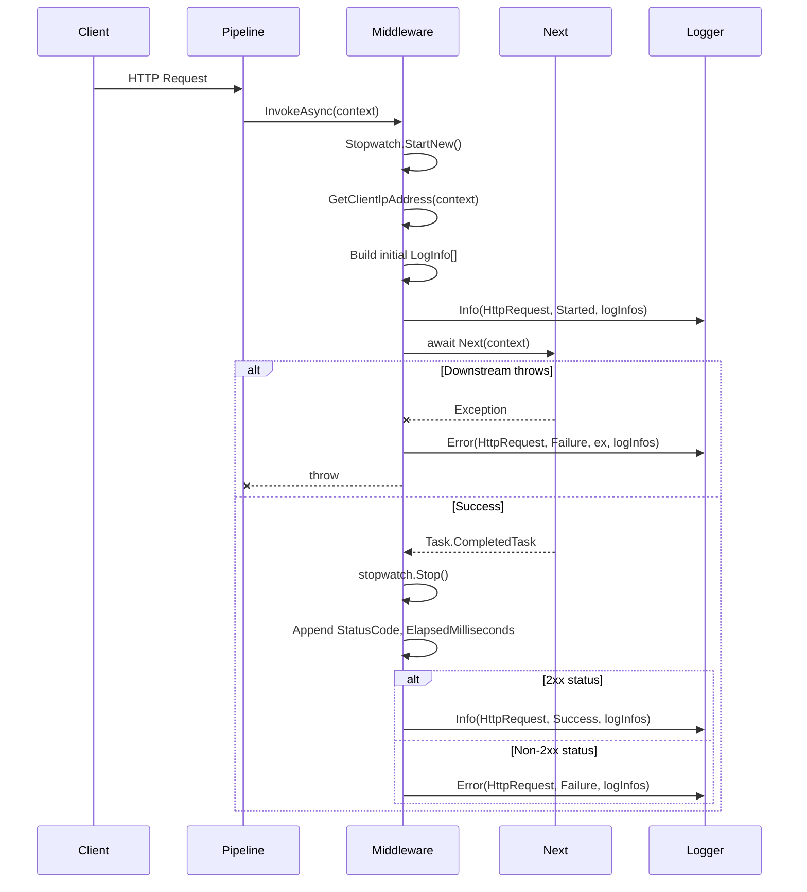

# Request Logging Flow

## Overview

This flow documents the end-to-end execution of a single HTTP request through `RequestLoggingMiddleware`.

## Prerequisites

1. Application configured with ASP.NET Core pipeline
2. `UseNuciApiRequestLogging()` called in pipeline
3. NuciLog configured with a logger implementation

## Sequence

## Step-by-Step

### 1. Pipeline Invocation

ASP.NET Core pipeline invokes `RequestLoggingMiddleware.InvokeAsync(context)` for each request.

### 2. Timing Start

`Stopwatch.StartNew()` begins measuring request duration.

### 3. Client Identification

`GetClientIpAddress(context)` resolves the client IP address.

### 4. Initial Log Event

A `Started` log event is emitted with:
- Method, Path, QueryString
- IpAddress, Hostname
- ClientId, RequestId, Timestamp, HmacToken (from headers)

### 5. Downstream Execution

`await Next(context)` passes the request to the next middleware/handler.

### 6a. Exception Path

If downstream throws:
- `Failure` log event emitted with exception
- Exception rethrown to preserve pipeline error handling

### 6b. Success Path

After `Next(context)` completes:
- Stopwatch stops
- StatusCode and ElapsedMilliseconds appended to log infos
- `Success` (2xx) or `Failure` (non-2xx) log event emitted

## Causal Dependencies

| Depends On | Reason |
|------------|--------|
| `context.Request.Method` | Request method for logging |
| `context.Request.Path` | Request path for logging |
| `context.Request.QueryString` | Query parameters for logging |
| `context.Request.Headers` | Correlation headers (ClientId, RequestId, etc.) |
| `NetworkUtils.GetClientIpAddress` | Client identification |
| `NetworkUtils.GetHostnames` | Hostname resolution |
| `context.Response.StatusCode` | Success/failure classification |
| `Stopwatch.ElapsedMilliseconds` | Performance measurement |

## Invariants Preserved

1. Exactly one `Started` event per request
2. Exactly one terminal event (Success/Failure) per request
3. Exception propagation preserved
4. Elapsed time measured from middleware entry to `Next` completion

## Related Flows

- None — this is the only flow in the repository

## Related Components

- [RequestLoggingMiddleware](./components/request-logging-middleware.md)
- [Logging Abstractions](./components/logging-abstractions.md)